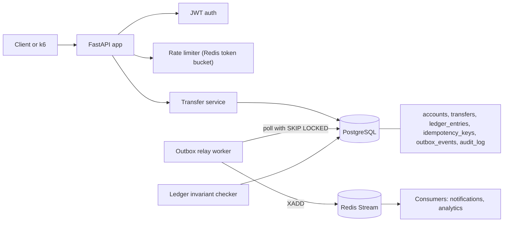
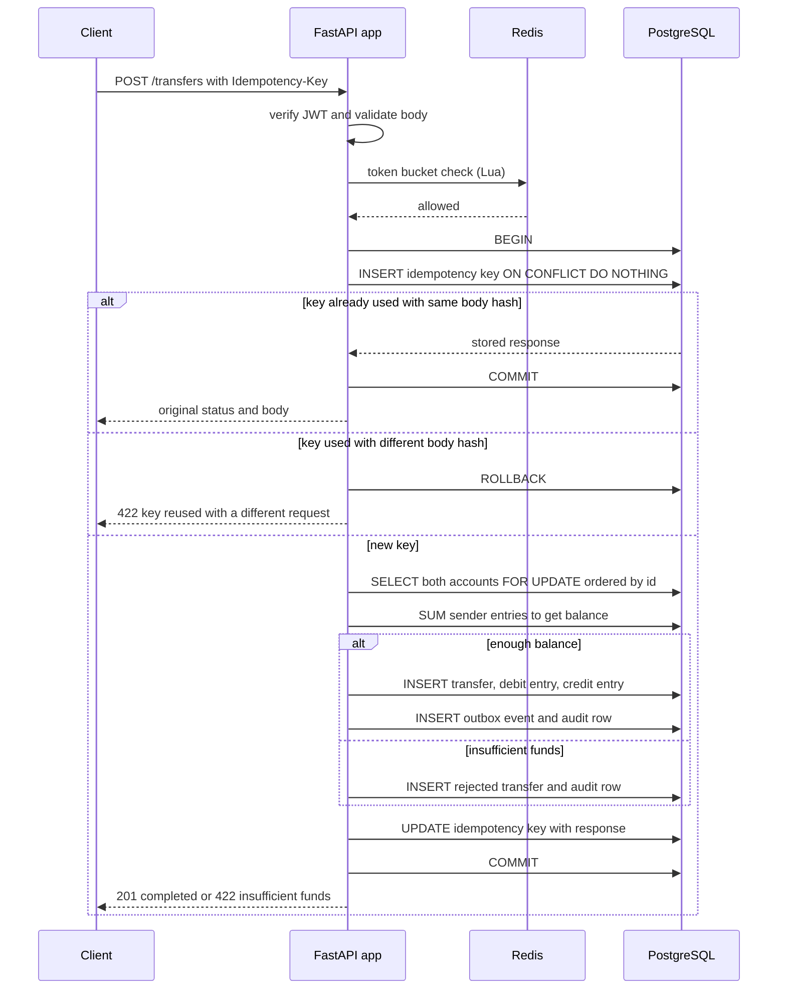
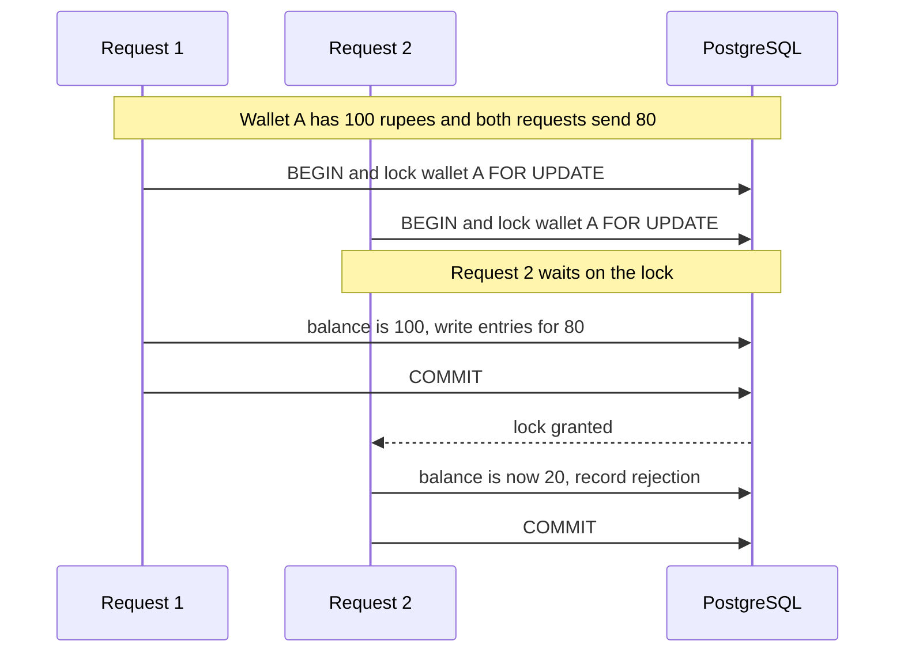
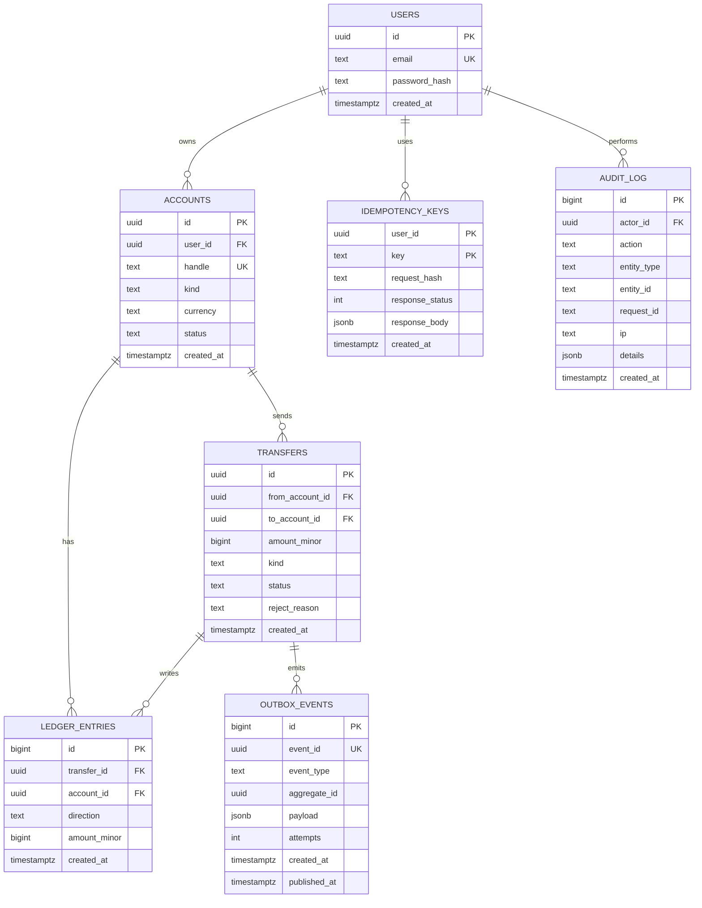
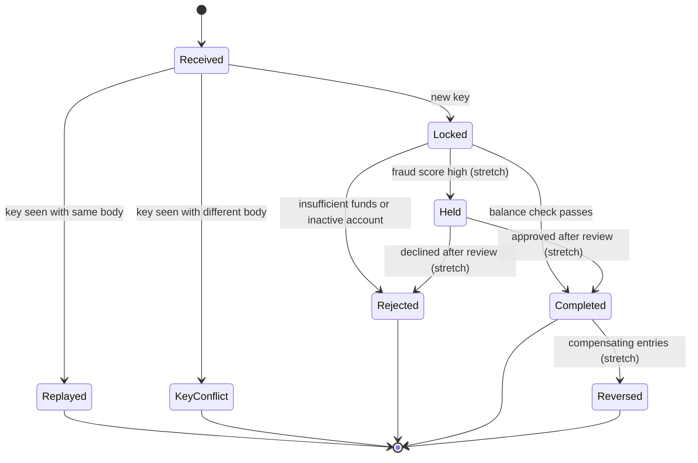
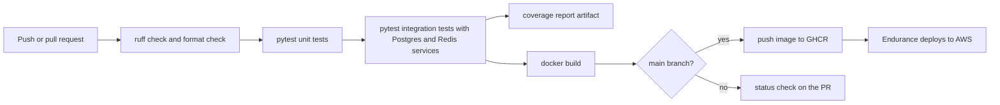
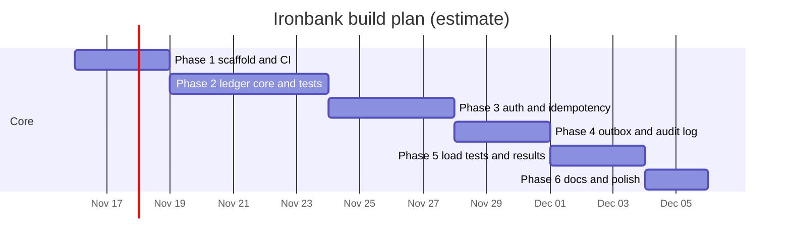

# Ironbank – Payments Ledger: interview prep

Companion to [README.md](README.md). Everything here describes the design and the plan. Where an answer needs a measured number, it says `[measured metric]` until a real run produces one.

---

## At a glance

### 30-second pitch

I built Ironbank, a small UPI-style payments API in FastAPI and PostgreSQL. It focuses on the three things a payments core has to get right: money is never created or lost, because every transfer writes balanced debit and credit entries in a double-entry ledger; a payment is never applied twice, because transfers take an Idempotency-Key; and parallel requests cannot overdraw a wallet, because account rows are locked with SELECT FOR UPDATE. I prove it with a concurrent double-spend test, a ledger invariant checker and k6 load tests, all running in CI.

### 2-minute walkthrough

Ironbank has users, wallets with UPI-style handles, and one system funding account. Money enters a wallet through a deposit, which is just a transfer from the funding account, so the total across all accounts always sums to zero.

When a client calls `POST /transfers`, the request goes through JWT auth and a Redis token bucket rate limiter. Then the transfer service opens a single Postgres transaction. First it inserts the idempotency key with a hash of the request body. If the key already exists with the same body, I return the stored response, so a retry after a timeout never moves money twice. Next I lock both account rows with SELECT FOR UPDATE, always in id order so two opposite transfers cannot deadlock. While holding the lock I compute the sender's balance from ledger entries. If there is enough money, I write the transfer row, one debit entry and one credit entry, an outbox event and an audit row, and store the response against the idempotency key. Then I commit. If anything fails, the whole thing rolls back.

Balances are never stored and edited; they are derived from entries. That means there is no balance column that can drift from history.

A separate relay worker reads the outbox table with SKIP LOCKED and publishes events to a Redis Stream. That avoids the dual-write problem where the database commits but the event is lost, or the reverse.

For testing, the key test funds a wallet with 100 rupees and fires 50 concurrent 10-rupee transfers from separate connections. Exactly 10 must succeed and the balance must end at zero. After every load test, an invariant checker confirms that debits equal credits across the whole ledger. k6 gives me p50 and p95 latency and the throughput where errors start. Everything runs with one `docker compose up`, and GitHub Actions runs lint, unit and integration tests against real Postgres and Redis on every push.

---

## Tech stack deep dive

| Tool | What it does here | Why this and not the alternative |
|---|---|---|
| Python 3.11 | Language for API, worker and scripts | Matches my experience; good typing and async ecosystem. Not Java/Spring: I can explain every line faster in Python |
| FastAPI | HTTP layer, dependency injection for auth and DB session, OpenAPI docs | Not Flask: built-in validation and OpenAPI. Not Django REST: I want explicit SQL transactions, not a full ORM-driven framework |
| Pydantic v2 | Request and response schemas, settings | Not hand-written validation: rejects bad input (negative amounts, extra fields) before it reaches the service |
| PostgreSQL 16 | Accounts, ledger entries, transfers, idempotency keys, outbox, audit log | Not MongoDB: I need multi-row ACID transactions, row locks and constraints. Not MySQL: `SKIP LOCKED`, partial indexes and triggers are simpler in Postgres and it is the common fintech choice |
| SQLAlchemy 2 (sync, psycopg 3) | Table models, explicit transactions, `with_for_update()` | Not raw SQL everywhere: models plus migrations are easier to maintain. Sync not async: simpler to reason about; the database is the bottleneck, and FastAPI runs sync routes in a thread pool |
| Alembic | Versioned schema migrations | Not `create_all()`: migrations are reviewable, repeatable in CI, and needed for zero-downtime changes later |
| Redis 7 | Token bucket rate limiter (Lua), Redis Stream for outbox events | Not in-process limits: they break with more than one API replica. Not Kafka in core: Redis is already there and a stream is enough to show the pattern |
| PyJWT + Argon2 | Access tokens and password hashing | Not server sessions: stateless tokens suit an API and multiple replicas. Argon2 not SHA-256: password hashes must be slow and memory-hard |
| pytest, pytest-cov, httpx | Unit, integration and concurrency tests, coverage | Not unittest: fixtures make real-database tests short. Not mocks for the DB: the guarantees live in Postgres, so tests must hit Postgres |
| k6 | Load tests with arrival-rate scenarios and thresholds | Not Locust: k6 has open-model executors and pass/fail thresholds built in, and runs as one binary in CI |
| Docker Compose | Runs API, relay worker, Postgres and Redis locally | Not Kubernetes: one command for a reviewer; Endurance handles cloud deployment |
| GitHub Actions | Lint, tests with service containers, image build and push | Not Jenkins: free for public repos and lives next to the code |
| ruff | Lint and format | Not flake8 + black + isort: one fast tool, one config |

### Concepts you must know

**FastAPI**
- `Depends()` for injecting the DB session, current user and rate limiter; dependencies with `yield` for setup and cleanup
- Sync `def` routes run in a thread pool (about 40 threads by default via AnyIO); `async def` routes run on the event loop and must not block
- Exception handlers to turn domain errors into RFC 9457 problem details
- How OpenAPI is generated from type hints and Pydantic models; adding examples and the `Idempotency-Key` header parameter

**Pydantic v2**
- `Annotated[int, Field(gt=0)]` for positive amounts; `ConfigDict(extra="forbid")` to reject unknown fields
- Separate input and output models so internal fields (password hash) never leak
- `pydantic-settings` for reading config from the environment

**PostgreSQL**
- Default isolation is `READ COMMITTED`; each statement sees data committed before it started
- `SELECT ... FOR UPDATE` blocks other `FOR UPDATE`, `UPDATE` and `DELETE` on those rows until commit, but not plain reads
- After waiting on a row lock in `READ COMMITTED`, Postgres re-reads the latest committed version of the row
- Deadlock detection after `deadlock_timeout` (1 second by default) aborts one transaction with SQLSTATE `40P01`
- `SKIP LOCKED` for queue-style polling; `SERIALIZABLE` raises `40001` and needs retries
- Unique index waits: an `INSERT` that conflicts with an uncommitted insert waits for that transaction to finish
- `CHECK` constraints (amount > 0, direction in debit/credit), `BIGINT` money, composite indexes on `(account_id, id)`

**SQLAlchemy 2 and Alembic**
- `Session` as a unit of work; `with session.begin():` for one explicit transaction
- `select(Account).where(...).with_for_update()`; ordering locks with `order_by(Account.id)`
- Connection pool size and `max_overflow`; pool exhaustion shows up as request timeouts
- Alembic autogenerate is a starting point and must be reviewed; `CREATE INDEX CONCURRENTLY` must run outside a transaction block
- Expand and contract migrations for schema changes without downtime

**Redis**
- Lua scripts run atomically, so read-refill-decrement in a token bucket cannot race
- Token bucket vs fixed window vs sliding window: fixed window allows a burst of 2x at the window edge
- Streams: `XADD`, consumer groups, `XREADGROUP`, `XACK`, and pending entries for redelivery
- Keys with TTL; memory limits and eviction policies

**JWT and auth**
- Header, payload, signature; `sub`, `exp`, `iat` claims; HS256 shared secret vs RS256 key pair
- Tokens cannot be revoked before `exp` without a deny list, so keep them short-lived
- Authorization is separate from authentication: every query filters by the owner's user id

**pytest**
- Fixtures with scopes; a session-scoped database with migrations applied, and a clean state per test
- Concurrency tests need separate connections per worker (a thread pool), not one shared session
- Marking slow integration tests; `--cov` and coverage reports in CI

**k6**
- Closed model (VUs loop) vs open model (`constant-arrival-rate`); the open model avoids coordinated omission
- Thresholds such as `http_req_duration: ['p(95)<300']` and `http_req_failed: ['rate<0.01']` fail the run
- `ramping-arrival-rate` to find the throughput where errors or latency break the threshold

**GitHub Actions**
- `services:` containers for Postgres and Redis with health checks
- Job dependencies with `needs`, caching pip, uploading coverage and k6 output as artifacts
- Pushing images to GHCR with `GITHUB_TOKEN` on the main branch only

---

## Charts and workflows

### 1. System flowchart

All money state lives in PostgreSQL. Redis holds only rate-limit buckets and the event stream, so losing Redis never loses money.

### 2. Transfer request sequence

Everything between BEGIN and COMMIT is atomic. A crash at any point leaves either the whole transfer or nothing.

### 3. Double-spend race, resolved by the row lock

Without the lock, both requests could read 100 and both succeed, leaving the wallet at minus 60. This is exactly what the concurrent test checks.

### 4. Data model

`kind` on accounts is `wallet` or `system`; on transfers it is `transfer` or `deposit`. A completed transfer has exactly two entries; a rejected one has none.

### 5. Transfer lifecycle

Only `Completed` and `Rejected` are stored transfer statuses in the core. `Held` (Precog) and `Reversed` are stretch goals. In the stretch design, the fraud score is checked after the balance check and before entries are written, so a held transfer has no entries until it is approved.

### 6. CI/CD workflow

CI runs on every push. Only the main branch publishes an image, which the Endurance repo deploys.

### 7. Build plan (plan only, not actual progress)

About 20 working days. Dates are illustrative; the order matches the build phases in CLAUDE.md.

---

## Interview questions with answers

### Project overview

**1. What is Ironbank in one sentence?**
A small payments API that moves money between wallets using a double-entry ledger, with idempotent transfers and row locking so retries and concurrent requests cannot create, lose or double-spend money.

**2. Why build a ledger instead of a balance column?**
A balance column updated in place loses history: if it is ever wrong, you cannot tell why. With a ledger, every movement is an immutable pair of entries, the balance is a sum over them, and any number can be traced to the transfers that produced it. It also gives a cheap global check: total debits must equal total credits.

**3. What was the hardest part?**
Getting idempotency and concurrency right together. A retry can arrive while the first request is still running, and two different transfers can hit the same wallet at once. Putting the idempotency key insert, the row locks and the ledger writes in one transaction made both cases fall out of Postgres semantics instead of application-level coordination.

**4. How do you know it is correct?**
Three layers. Integration tests against real Postgres check each rule. A concurrent double-spend test fires parallel transfers at one wallet and asserts the exact number of successes and a final balance of zero. After every test run and load test, an invariant checker confirms that debits equal credits per transfer and globally, and that no wallet is negative.

### Design decisions and trade-offs

**5. Why store money as integer paise?**
Floating point cannot represent values like 0.1 exactly, so sums drift. Integer minor units in a `BIGINT` are exact and fast. `NUMERIC` would also be exact, but integers make the arithmetic and the API (`amount_minor`) unambiguous and match what payment providers such as Stripe expose.

**6. Pessimistic or optimistic locking, and why?**
I used pessimistic locking with `SELECT ... FOR UPDATE`. Wallets in a payments system see real contention, and under optimistic locking each conflict means a failed update and a retry of the whole transaction, which wastes work and adds tail latency. Optimistic versioning is better when conflicts are rare and transactions are long. It is a stretch goal to build both and compare them under the same k6 load.

**7. How do you avoid deadlocks?**
Every transfer locks both account rows in ascending id order. A deadlock needs two transactions waiting on each other in a cycle, and a global lock order makes a cycle impossible. Postgres would still detect a deadlock and abort one transaction with `40P01`, but with ordered locks that should never happen, and a test with opposite transfers (A to B and B to A in parallel) checks it.

**8. Why READ COMMITTED and not SERIALIZABLE?**
The row locks already serialize everything that touches one wallet, so `READ COMMITTED` plus explicit locks is enough and is the Postgres default. `SERIALIZABLE` would also be correct, but it aborts transactions with `40001` under contention, so every write path needs a retry loop. Explicit locks make the critical section visible in the code, which is easier to explain and debug.

**9. Why are balances derived from entries if summing is slower?**
Correctness first: there is no second copy of the truth to drift. With an index on `(account_id)` the sum is cheap for the data sizes here. At larger scale I would add a cached balance column updated in the same transaction, or periodic balance snapshots plus a sum of newer entries, and keep the invariant checker comparing them.

**10. Why keep idempotency keys in Postgres and not Redis?**
The key and the transfer must commit or roll back together. If the key lived in Redis, a crash between writing the transfer and writing the key would let a retry create a second transfer. In Postgres they share one transaction. Redis could be added as a read-through cache for fast replays, but it would not be the source of truth.

**11. What happens if two requests with the same Idempotency-Key arrive at the same time?**
Both try to insert the key inside their transaction. The second insert conflicts with the first, uncommitted row and waits on the unique index. When the first commits, the second sees the conflict, reads the stored response and returns it. If the first rolls back, the second proceeds as a new request. No in-progress state or extra locking is needed.

**12. Why use an outbox instead of publishing the event after commit?**
Publishing after commit is a dual write: if the process crashes between commit and publish, the event is lost; if you publish before commit and the commit fails, consumers see a payment that never happened. The outbox row is written in the same transaction as the entries, so it exists if and only if the transfer does. A relay publishes it later, at least once.

**13. Why JWT and not sessions?**
The API is stateless and can run as several replicas behind a load balancer without shared session storage. The downside is that a token cannot be revoked before it expires, so access tokens last 15 minutes. Refresh tokens and a Redis deny list for logout are possible extensions.

**14. Why sync SQLAlchemy instead of async?**
The work per request is a short database transaction, so the database is the bottleneck, not the Python thread. Sync code with a thread pool is easier to read and debug, and lock behavior is easier to reason about. Async would help with many slow external calls, which matters if the Precog fraud call is added.

### Deep dives per tool

**15. How does FastAPI dependency injection work in this project?**
Routes declare `Depends(get_session)`, `Depends(current_user)` and `Depends(rate_limit)`. FastAPI resolves them per request, and dependencies that `yield` run cleanup after the response, which is where the session is closed. Tests override dependencies with `app.dependency_overrides` to point at the test database.

**16. What exactly does SELECT FOR UPDATE lock, and what does it not block?**
It takes a row-level lock on the selected rows that blocks other `FOR UPDATE`, `FOR SHARE`, `UPDATE` and `DELETE` on those rows until the transaction ends. Plain `SELECT` statements are not blocked because Postgres uses MVCC; they see the last committed version. That is why the balance check must happen after taking the lock, inside the same transaction.

**17. How does the outbox relay avoid two workers sending the same event?**
It selects a batch with `WHERE published_at IS NULL ORDER BY id LIMIT 100 FOR UPDATE SKIP LOCKED`. Rows locked by one worker are skipped by another, so workers split the batch instead of blocking. If a worker crashes after publishing but before marking the row, the event is sent again, which is why consumers deduplicate on `event_id`.

**18. How does the Redis token bucket work, and why Lua?**
Each user has a hash with tokens and a last-refill timestamp. On a request, the script refills tokens based on elapsed time up to the bucket size, then takes one if available, and sets a TTL. Running it as one Lua script makes the read-modify-write atomic, so two parallel requests cannot both take the last token. If no token is left the API returns `429` with `Retry-After`.

**19. How do Alembic migrations run, and what would make one unsafe in production?**
`alembic upgrade head` runs in CI before tests and in the container before the API starts. Unsafe migrations are ones that take long locks on big tables, such as adding a column with a volatile default (which rewrites the whole table), adding an index without `CONCURRENTLY`, or renaming a column the running code still reads. The safe pattern is expand, migrate data, then contract across separate deploys.

**20. How do you write the concurrent double-spend test in pytest?**
A fixture creates a wallet and deposits 100 rupees. The test uses a `ThreadPoolExecutor` with 50 workers, each with its own session or HTTP client, all sending a 10-rupee transfer with a unique Idempotency-Key, released together by a barrier. It asserts exactly 10 completed and 40 rejected transfers, a final balance of zero, and a clean invariant check.

**21. How do you keep integration tests isolated?**
A session-scoped fixture starts from a migrated database. Normal tests run inside a transaction that is rolled back at the end. Concurrency tests cannot share one transaction, so they use committed data and truncate the tables afterward. In CI, Postgres and Redis run as service containers.

**22. What do the k6 scenarios measure?**
A `constant-arrival-rate` scenario sends transfers at a fixed rate to get p50 and p95 latency without coordinated omission. A `ramping-arrival-rate` scenario raises the rate until the error rate passes 1% or p95 passes the threshold, which gives max transfers per second. A retry scenario resends each request with the same key to check zero duplicates. Thresholds make the run fail if limits are crossed.

**23. How does Pydantic protect the ledger?**
`amount_minor` is `Annotated[int, Field(gt=0, le=MAX_TRANSFER_MINOR)]`, so zero, negative and absurd amounts never reach the service. `extra="forbid"` rejects unknown fields, which catches client typos. Response models are separate from DB models, so internal fields are never returned. The database repeats the key rules as `CHECK` constraints in case code changes later.

**24. How is the audit log made append-only?**
A Postgres trigger on `audit_log` raises an exception on `UPDATE` or `DELETE`. Rows for money movements are written in the same transaction as the transfer, so there is no transfer without an audit record. In production I would also give the app's database role only `INSERT` and `SELECT` on that table.

### Scaling and failure modes

**25. What happens if the API process crashes in the middle of a transfer?**
The transaction never commits, so Postgres rolls it back: no entries, no outbox row, no idempotency record. The client sees a timeout and retries with the same key, which is processed as new. If the crash happened after commit but before the response, the retry finds the key and gets the stored response.

**26. What if Redis goes down?**
The rate limiter fails open and logs a warning, because correctness does not depend on it. The outbox relay cannot publish, so events pile up in the outbox table and are sent when Redis returns. No money state is lost, since all of it is in Postgres. I would alert on outbox lag.

**27. A merchant wallet receives thousands of payments per second. What breaks?**
Every transfer locks both rows, so all payments to that merchant serialize on one row lock and latency grows. Credits cannot overdraw an account, so one fix is to lock only the debited account and take no lock on the receiver. Others are splitting the merchant into several sub-accounts and summing them, or batching credits.

**28. How would you scale to 10x traffic?**
First measure where time goes. Likely steps: tune the connection pool and add PgBouncer, run several API replicas, add a cached balance column so balance reads do not scan entries, move balance and history reads to a read replica, and partition `ledger_entries` by time. Beyond that, shard accounts by id so each shard owns its wallets, with cross-shard transfers handled through a saga.

**29. The outbox relay is down for an hour. What happens?**
Transfers keep working because the relay is not on the request path. The outbox table grows, and consumers see events late. When the relay restarts it drains the backlog in order of id. I would monitor the age of the oldest unpublished row and alert on it.

**30. How long do you keep idempotency keys, and why does it matter?**
24 hours, which covers realistic client retry windows. A periodic job deletes expired keys so the table and its index stay small. If keys were kept forever the table would grow without bound; if kept too briefly, a slow retry could create a duplicate.

### Debugging scenarios

**31. p95 latency on POST /transfers jumped after a deploy. What do you check?**
Compare k6 runs before and after to confirm it. Then look at Postgres: `pg_stat_activity` for sessions waiting on locks, `pg_stat_statements` for slow queries, and `EXPLAIN ANALYZE` on the balance sum to check it still uses the `(account_id)` index. Then check pool usage, since pool waits look like slow queries from the app side, and finally the Redis call latency.

**32. You see deadlock errors in the logs. What happened?**
Some code path is taking locks in a different order, for example a new endpoint that locks the receiver first, or a transaction that touches accounts and then another table that another path touches first. I would find the two statements from the Postgres deadlock log, which lists both, and route all locking through one helper that sorts ids.

**33. The invariant checker reports balance drift. How do you investigate?**
Find which check fails: a transfer with unbalanced entries, a negative wallet, or a global debit-credit mismatch. Unbalanced transfers point to code that writes entries outside the shared helper or to a missing transaction boundary. I would add a deferred constraint or a check in the helper so it cannot recur, and fix the data with compensating entries rather than edits.

**34. Clients report 422 "key reused with a different request" spikes.**
Usually a client generates one key per session or per screen instead of per payment attempt, or it changes the body on retry (for example adding a timestamp). I would check the logs for the key and both request hashes, confirm which field differs, and fix the client. If the body is reordered JSON, the server should canonicalize it before hashing.

**35. The double-spend test passes locally but is flaky in CI.**
Likely causes are shared state between tests, too few database connections for the thread pool so some requests time out, or the test not waiting for all futures before asserting. I would make the pool size at least the worker count, add a barrier so requests really start together, assert on the exact counts, and print the transfer statuses on failure.

**36. Requests hang under load and then time out with no database errors.**
That is usually connection pool exhaustion: every worker thread is waiting for a connection, often because some code path holds a session too long or leaks one. Check pool metrics and `pg_stat_activity` for idle-in-transaction sessions. Fixes are to keep transactions short, never call slow external services inside one, and set pool timeouts so the failure is fast and visible.

### Behavioral (STAR outlines)

Fill the blanks with real outcomes after each phase ships.

**37. Tell me about a hard bug you found.**
- Situation: while building the transfer endpoint, the first concurrency test showed `[measured result, e.g. how many transfers overspent]`.
- Task: make concurrent transfers on one wallet safe without hurting latency too much.
- Action: traced it to reading the balance before taking the lock, moved the lock first, added ordered locking, and kept the test in CI.
- Result: `[measured metric: double-spend test passes, drift 0, p95 change]`.

**38. Tell me about a trade-off you made.**
- Situation: choosing between pessimistic and optimistic locking.
- Task: pick one that is correct and that I can defend.
- Action: chose `FOR UPDATE` with ordered locks, documented why, and planned an optimistic variant as a benchmark.
- Result: `[measured metric: latency and throughput of the chosen approach]`.

**39. Tell me about cutting scope.**
- Situation: the first design included Kafka, a fraud model, dbt and LLM features.
- Task: ship a core I could explain line by line in about three weeks.
- Action: kept the ledger, idempotency, locking, outbox and tests as core, moved Kafka, fraud scoring and analytics to stretch goals.
- Result: `[what shipped and when, measured coverage]`.

**40. Tell me about learning something new quickly.**
- Situation: I had used Postgres as a store but not its locking model.
- Task: understand isolation levels and row locks well enough to prove correctness.
- Action: read the Postgres docs on concurrency control, reproduced the race in a test before fixing it, and wrote a short note in `docs/`.
- Result: `[measured metric or concrete outcome]`.

---

## Trade-offs and what I'd change at 10x scale

| Decision now | Why it is fine now | What I would change at 10x |
|---|---|---|
| Balance derived by summing entries | Simple, no drift, fast enough with an index | Cached balance column updated in the same transaction, or daily snapshots plus recent entries; keep the checker comparing both |
| Lock both accounts per transfer | Easy to prove correct, no deadlocks with ordering | Lock only the debited account; split hot merchant accounts into sub-accounts |
| Single Postgres primary | One transaction covers everything | PgBouncer, read replicas for balance and history reads, time-partitioned `ledger_entries`, then sharding by account id |
| Redis Stream as event sink | Already in the stack, enough to show the outbox | Kafka with partitions keyed by account id and consumer groups per downstream system |
| Sync SQLAlchemy and a thread pool | Short DB-bound requests | Async if requests start calling slow external services (fraud scoring) |
| HS256 JWT with one secret | One service | RS256 with key rotation, refresh tokens, a deny list for logout |
| Polling outbox relay | Simple and easy to reason about | Logical replication or Debezium change data capture to avoid polling |
| Single currency (INR) | Matches UPI | Currency per account, FX as a separate pair of entries through an FX account |

---

## Resume bullets

Templates only. Replace each placeholder with a number from `docs/results/`.

- Built a UPI-style payments API in FastAPI and PostgreSQL with a double-entry ledger and idempotent transfers; sustained `[measured metric: transfers/sec]` at p95 `[measured metric: ms]` under k6 load with zero duplicate transfers across `[measured metric: retried requests]`
- Prevented double-spends with ordered `SELECT FOR UPDATE` row locks, verified by a concurrent test of `[measured metric: N]` parallel transfers and a ledger invariant checker showing `[measured metric: drift]` drift after load
- Added JWT auth, Redis token bucket rate limiting, a transactional outbox and an append-only audit log; `[measured metric: coverage]`% test coverage with pytest integration tests against real Postgres and Redis in GitHub Actions

---

## Glossary

- **Double-entry ledger**: every movement of money is recorded as a debit on one account and a credit of the same amount on another, so the books always balance
- **Ledger entry**: one immutable line in the ledger (account, direction, amount)
- **Debit and credit**: the two sides of an entry; for a wallet, credits increase the balance and debits decrease it
- **Minor units**: the smallest unit of a currency, here paise (1 rupee = 100 paise)
- **Funding account**: a system account that money comes from on deposit, so the global total stays zero
- **Idempotency**: doing an operation twice has the same effect as doing it once
- **Idempotency-Key**: a client-chosen unique id sent as a header so the server can recognize retries
- **Row lock**: a lock on specific table rows held until the transaction ends
- **SELECT FOR UPDATE**: a query that reads rows and locks them against concurrent writers
- **SKIP LOCKED**: a clause that makes a query skip rows locked by others, used for job queues
- **Deadlock**: two transactions each waiting for a lock the other holds
- **Isolation level**: how much of other concurrent transactions a transaction can see (READ COMMITTED, REPEATABLE READ, SERIALIZABLE)
- **Optimistic locking**: no lock on read; a version check on write fails if someone else changed the row
- **MVCC**: multi-version concurrency control; readers see a snapshot and do not block writers
- **Transactional outbox**: writing events to a table in the same transaction as the data change, then publishing them separately
- **At-least-once delivery**: every event is delivered, possibly more than once, so consumers must deduplicate
- **Dual write**: writing to two systems without a shared transaction, which can leave them inconsistent
- **Audit log**: an append-only record of who did what and when
- **JWT**: a signed token carrying claims such as user id and expiry
- **Token bucket**: a rate limit where tokens refill at a steady rate and each request spends one
- **p50 and p95 latency**: the response time that 50% and 95% of requests are faster than
- **Open vs closed load model**: open sends requests at a fixed rate regardless of responses; closed waits for each response before the next
- **Coordinated omission**: a load-test error where a slow server also slows the test client, hiding real latency
- **Balance drift**: a difference between a balance and what the ledger entries say it should be
- **Invariant**: a rule that must always hold, such as total debits equal total credits
- **UPI handle (VPA)**: a payment address like `name@bank` used instead of an account number
- **Problem details (RFC 9457)**: a standard JSON format for HTTP API errors
