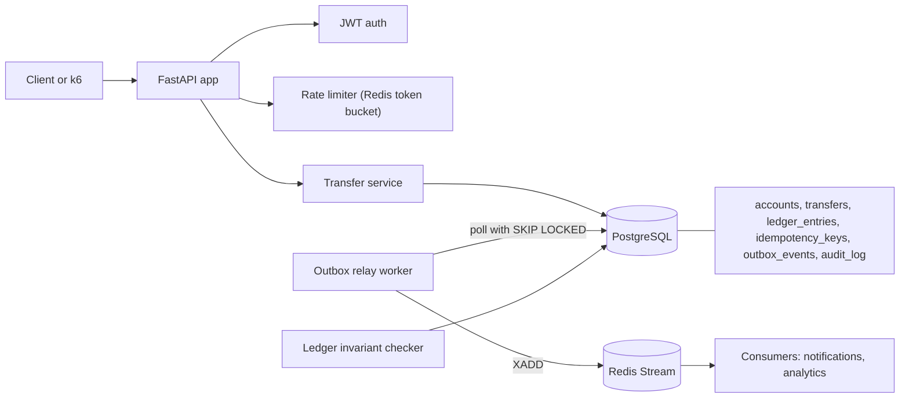
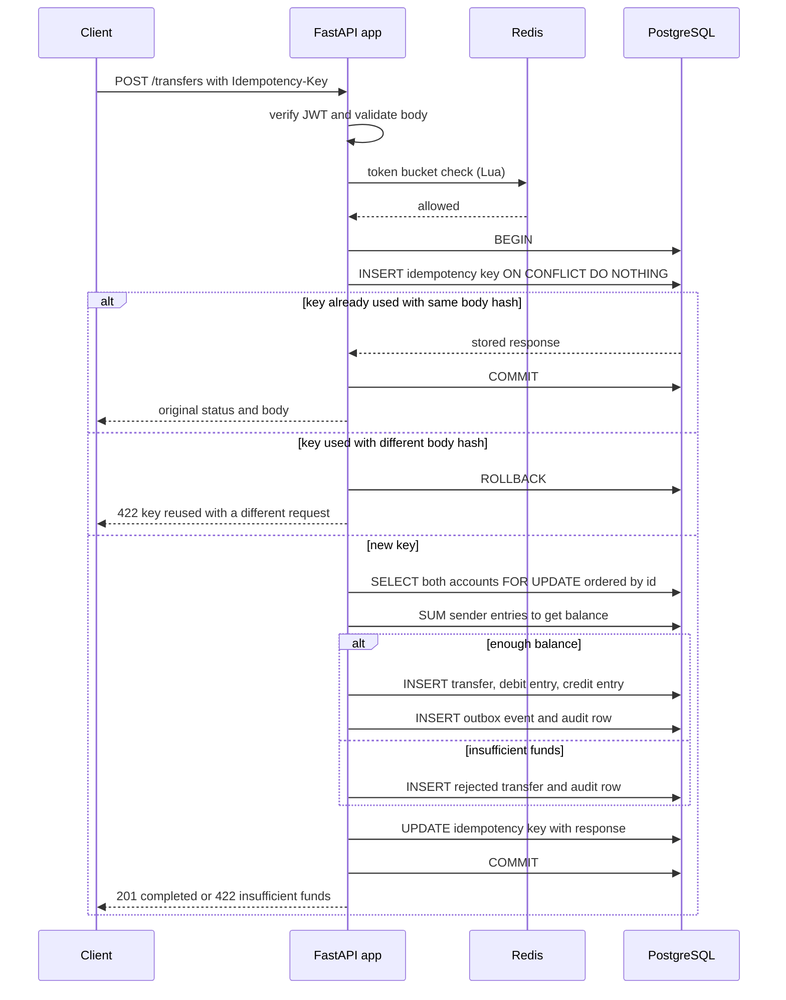
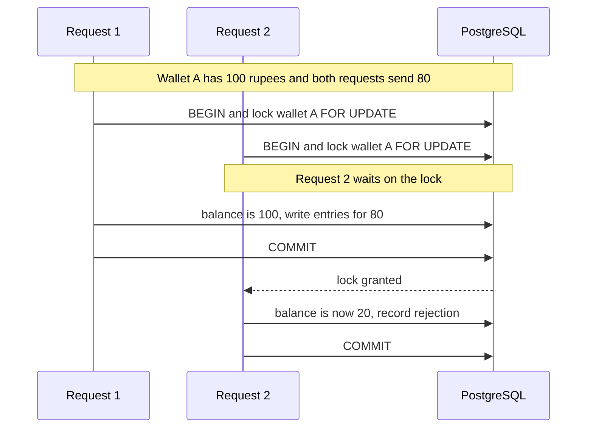
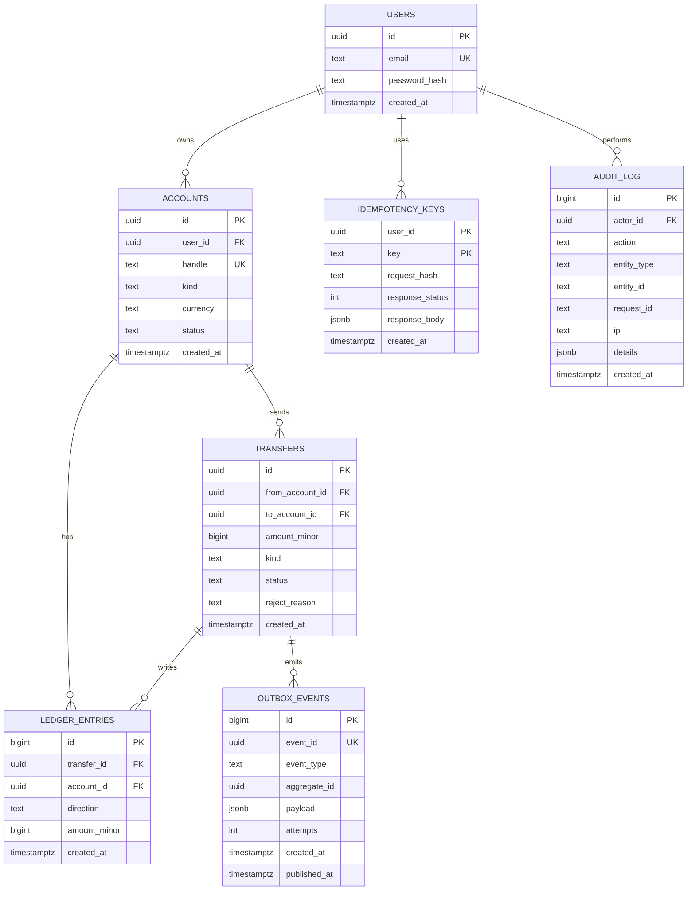
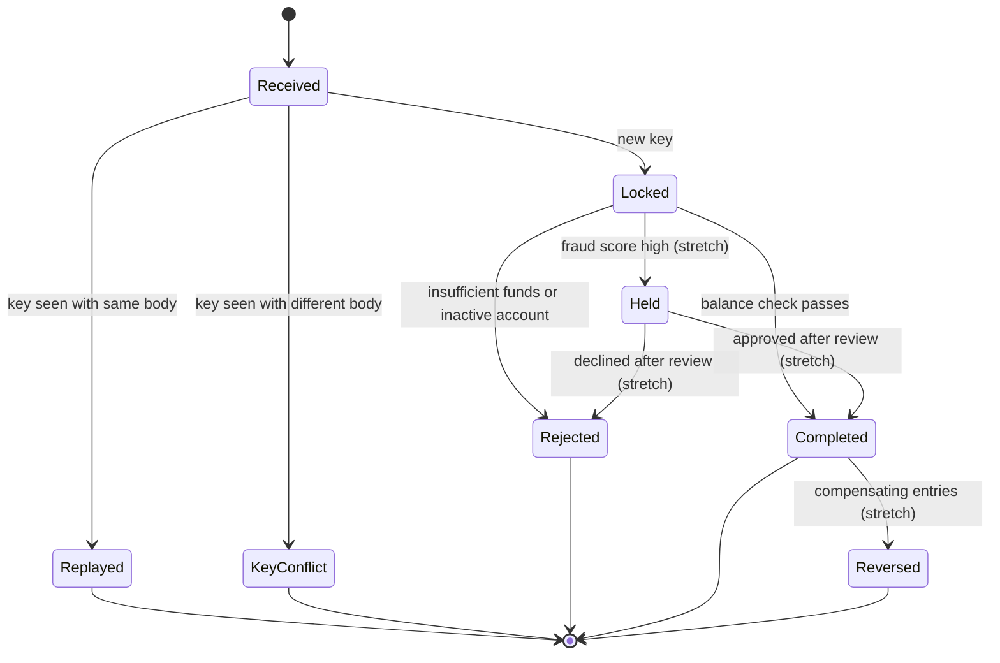
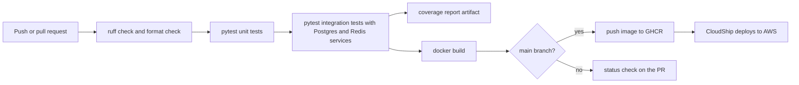
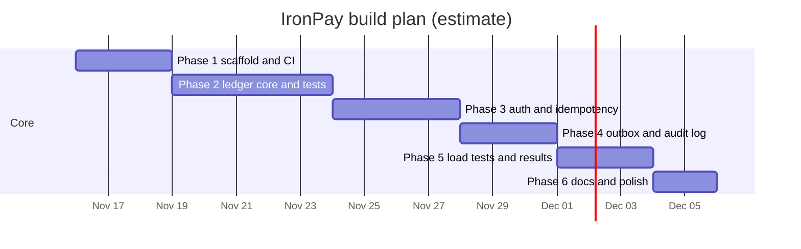

# IronPay LedgerAPI: overview, system design and workflow

Companion to [README.md](README.md). Pitches, interview questions and resume bullets are in [INTERVIEW.md](INTERVIEW.md). The core is built (phases 1 to 6); measured results are in the README and `docs/results/`.

---

## Overview

IronPay has users, wallets with UPI-style handles, and one system funding account. Money enters a wallet through a deposit, which is just a transfer from the funding account, so the total across all accounts always sums to zero.

When a client calls `POST /transfers`, the request goes through JWT auth and a Redis token bucket rate limiter. Then the transfer service opens a single Postgres transaction. First it inserts the idempotency key with a hash of the request body. If the key already exists with the same body, I return the stored response, so a retry after a timeout never moves money twice. Next I lock both account rows with SELECT FOR UPDATE, always in id order so two opposite transfers cannot deadlock. While holding the lock I compute the sender's balance from ledger entries. If there is enough money, I write the transfer row, one debit entry and one credit entry, an outbox event and an audit row, and store the response against the idempotency key. Then I commit. If anything fails, the whole thing rolls back.

Balances are never stored and edited; they are derived from entries. That means there is no balance column that can drift from history.

A separate relay worker reads the outbox table with SKIP LOCKED and publishes events to a Redis Stream. That avoids the dual-write problem where the database commits but the event is lost, or the reverse.

For testing, the key test funds a wallet with 100 rupees and fires 50 concurrent 10-rupee transfers from separate connections. Exactly 10 must succeed and the balance must end at zero. After every load test, an invariant checker confirms that debits equal credits across the whole ledger. k6 gives me p50 and p95 latency and the throughput where errors start. Everything runs with one `docker compose up`, and GitHub Actions runs lint, unit and integration tests against real Postgres and Redis on every push.

---

## Tech stack deep dive

| Tool | What it does here | Why this and not the alternative |
|---|---|---|
| Python 3.11 | Language for API, worker and scripts | Matches my experience; good typing and async ecosystem. Not Java/Spring: I can explain every line faster in Python |
| FastAPI | HTTP layer, dependency injection for auth and DB session, OpenAPI docs | Not Flask: built-in validation and OpenAPI. Not Django REST: I want explicit SQL transactions, not a full ORM-driven framework |
| Pydantic v2 | Request and response schemas, settings | Not hand-written validation: rejects bad input (negative amounts, extra fields) before it reaches the service |
| PostgreSQL 16 | Accounts, ledger entries, transfers, idempotency keys, outbox, audit log | Not MongoDB: I need multi-row ACID transactions, row locks and constraints. Not MySQL: `SKIP LOCKED`, partial indexes and triggers are simpler in Postgres and it is the common fintech choice |
| SQLAlchemy 2 (sync, psycopg 3) | Table models, explicit transactions, `with_for_update()` | Not raw SQL everywhere: models plus migrations are easier to maintain. Sync not async: simpler to reason about; the database is the bottleneck, and FastAPI runs sync routes in a thread pool |
| Alembic | Versioned schema migrations | Not `create_all()`: migrations are reviewable, repeatable in CI, and needed for zero-downtime changes later |
| Redis 7 | Token bucket rate limiter (Lua), Redis Stream for outbox events | Not in-process limits: they break with more than one API replica. Not Kafka in core: Redis is already there and a stream is enough to show the pattern |
| PyJWT + Argon2 | Access tokens and password hashing | Not server sessions: stateless tokens suit an API and multiple replicas. Argon2 not SHA-256: password hashes must be slow and memory-hard |
| pytest, pytest-cov, httpx | Unit, integration and concurrency tests, coverage | Not unittest: fixtures make real-database tests short. Not mocks for the DB: the guarantees live in Postgres, so tests must hit Postgres |
| k6 | Load tests with arrival-rate scenarios and thresholds | Not Locust: k6 has open-model executors and pass/fail thresholds built in, and runs as one binary in CI |
| Docker Compose | Runs API, relay worker, Postgres and Redis locally | Not Kubernetes: one command for a reviewer; CloudShip handles cloud deployment |
| GitHub Actions | Lint, tests with service containers, image build and push | Not Jenkins: free for public repos and lives next to the code |
| ruff | Lint and format | Not flake8 + black + isort: one fast tool, one config |

### Concepts you must know

**FastAPI**
- `Depends()` for injecting the DB session, current user and rate limiter; dependencies with `yield` for setup and cleanup
- Sync `def` routes run in a thread pool (about 40 threads by default via AnyIO); `async def` routes run on the event loop and must not block
- Exception handlers to turn domain errors into RFC 9457 problem details
- How OpenAPI is generated from type hints and Pydantic models; adding examples and the `Idempotency-Key` header parameter

**Pydantic v2**
- `Annotated[int, Field(gt=0)]` for positive amounts; `ConfigDict(extra="forbid")` to reject unknown fields
- Separate input and output models so internal fields (password hash) never leak
- `pydantic-settings` for reading config from the environment

**PostgreSQL**
- Default isolation is `READ COMMITTED`; each statement sees data committed before it started
- `SELECT ... FOR UPDATE` blocks other `FOR UPDATE`, `UPDATE` and `DELETE` on those rows until commit, but not plain reads
- After waiting on a row lock in `READ COMMITTED`, Postgres re-reads the latest committed version of the row
- Deadlock detection after `deadlock_timeout` (1 second by default) aborts one transaction with SQLSTATE `40P01`
- `SKIP LOCKED` for queue-style polling; `SERIALIZABLE` raises `40001` and needs retries
- Unique index waits: an `INSERT` that conflicts with an uncommitted insert waits for that transaction to finish
- `CHECK` constraints (amount > 0, direction in debit/credit), `BIGINT` money, composite indexes on `(account_id, id)`

**SQLAlchemy 2 and Alembic**
- `Session` as a unit of work; `with session.begin():` for one explicit transaction
- `select(Account).where(...).with_for_update()`; ordering locks with `order_by(Account.id)`
- Connection pool size and `max_overflow`; pool exhaustion shows up as request timeouts
- Alembic autogenerate is a starting point and must be reviewed; `CREATE INDEX CONCURRENTLY` must run outside a transaction block
- Expand and contract migrations for schema changes without downtime

**Redis**
- Lua scripts run atomically, so read-refill-decrement in a token bucket cannot race
- Token bucket vs fixed window vs sliding window: fixed window allows a burst of 2x at the window edge
- Streams: `XADD`, consumer groups, `XREADGROUP`, `XACK`, and pending entries for redelivery
- Keys with TTL; memory limits and eviction policies

**JWT and auth**
- Header, payload, signature; `sub`, `exp`, `iat` claims; HS256 shared secret vs RS256 key pair
- Tokens cannot be revoked before `exp` without a deny list, so keep them short-lived
- Authorization is separate from authentication: every query filters by the owner's user id

**pytest**
- Fixtures with scopes; a session-scoped database with migrations applied, and a clean state per test
- Concurrency tests need separate connections per worker (a thread pool), not one shared session
- Marking slow integration tests; `--cov` and coverage reports in CI

**k6**
- Closed model (VUs loop) vs open model (`constant-arrival-rate`); the open model avoids coordinated omission
- Thresholds such as `http_req_duration: ['p(95)<300']` and `http_req_failed: ['rate<0.01']` fail the run
- `ramping-arrival-rate` to find the throughput where errors or latency break the threshold

**GitHub Actions**
- `services:` containers for Postgres and Redis with health checks
- Job dependencies with `needs`, caching pip, uploading coverage and k6 output as artifacts
- Pushing images to GHCR with `GITHUB_TOKEN` on the main branch only

---

## System design and workflows

### 1. System flowchart

All money state lives in PostgreSQL. Redis holds only rate-limit buckets and the event stream, so losing Redis never loses money.

### 2. Transfer request sequence

Everything between BEGIN and COMMIT is atomic. A crash at any point leaves either the whole transfer or nothing.

### 3. Double-spend race, resolved by the row lock

Without the lock, both requests could read 100 and both succeed, leaving the wallet at minus 60. This is exactly what the concurrent test checks.

### 4. Data model

`kind` on accounts is `wallet` or `system`; on transfers it is `transfer` or `deposit`. A completed transfer has exactly two entries; a rejected one has none.

### 5. Transfer lifecycle

Only `Completed` and `Rejected` are stored transfer statuses in the core. `Held` (FraudSight) and `Reversed` are stretch goals. In the stretch design, the fraud score is checked after the balance check and before entries are written, so a held transfer has no entries until it is approved.

### 6. CI/CD workflow

CI runs on every push. Only the main branch publishes an image, which the CloudShip repo deploys.

### 7. Build plan (plan only, not actual progress)

About 20 working days. Dates are illustrative; the order matches the build phases in CLAUDE.md.

---

## Trade-offs and what I'd change at 10x scale

| Decision now | Why it is fine now | What I would change at 10x |
|---|---|---|
| Balance derived by summing entries | Simple, no drift, fast enough with an index | Cached balance column updated in the same transaction, or daily snapshots plus recent entries; keep the checker comparing both |
| Lock both accounts per transfer | Easy to prove correct, no deadlocks with ordering | Lock only the debited account; split hot merchant accounts into sub-accounts |
| Single Postgres primary | One transaction covers everything | PgBouncer, read replicas for balance and history reads, time-partitioned `ledger_entries`, then sharding by account id |
| Redis Stream as event sink | Already in the stack, enough to show the outbox | Kafka with partitions keyed by account id and consumer groups per downstream system |
| Sync SQLAlchemy and a thread pool | Short DB-bound requests | Async if requests start calling slow external services (fraud scoring) |
| HS256 JWT with one secret | One service | RS256 with key rotation, refresh tokens, a deny list for logout |
| Polling outbox relay | Simple and easy to reason about | Logical replication or Debezium change data capture to avoid polling |
| Single currency (INR) | Matches UPI | Currency per account, FX as a separate pair of entries through an FX account |

---

## Glossary

- **Double-entry ledger**: every movement of money is recorded as a debit on one account and a credit of the same amount on another, so the books always balance
- **Ledger entry**: one immutable line in the ledger (account, direction, amount)
- **Debit and credit**: the two sides of an entry; for a wallet, credits increase the balance and debits decrease it
- **Minor units**: the smallest unit of a currency, here paise (1 rupee = 100 paise)
- **Funding account**: a system account that money comes from on deposit, so the global total stays zero
- **Idempotency**: doing an operation twice has the same effect as doing it once
- **Idempotency-Key**: a client-chosen unique id sent as a header so the server can recognize retries
- **Row lock**: a lock on specific table rows held until the transaction ends
- **SELECT FOR UPDATE**: a query that reads rows and locks them against concurrent writers
- **SKIP LOCKED**: a clause that makes a query skip rows locked by others, used for job queues
- **Deadlock**: two transactions each waiting for a lock the other holds
- **Isolation level**: how much of other concurrent transactions a transaction can see (READ COMMITTED, REPEATABLE READ, SERIALIZABLE)
- **Optimistic locking**: no lock on read; a version check on write fails if someone else changed the row
- **MVCC**: multi-version concurrency control; readers see a snapshot and do not block writers
- **Transactional outbox**: writing events to a table in the same transaction as the data change, then publishing them separately
- **At-least-once delivery**: every event is delivered, possibly more than once, so consumers must deduplicate
- **Dual write**: writing to two systems without a shared transaction, which can leave them inconsistent
- **Audit log**: an append-only record of who did what and when
- **JWT**: a signed token carrying claims such as user id and expiry
- **Token bucket**: a rate limit where tokens refill at a steady rate and each request spends one
- **p50 and p95 latency**: the response time that 50% and 95% of requests are faster than
- **Open vs closed load model**: open sends requests at a fixed rate regardless of responses; closed waits for each response before the next
- **Coordinated omission**: a load-test error where a slow server also slows the test client, hiding real latency
- **Balance drift**: a difference between a balance and what the ledger entries say it should be
- **Invariant**: a rule that must always hold, such as total debits equal total credits
- **UPI handle (VPA)**: a payment address like `name@bank` used instead of an account number
- **Problem details (RFC 9457)**: a standard JSON format for HTTP API errors
