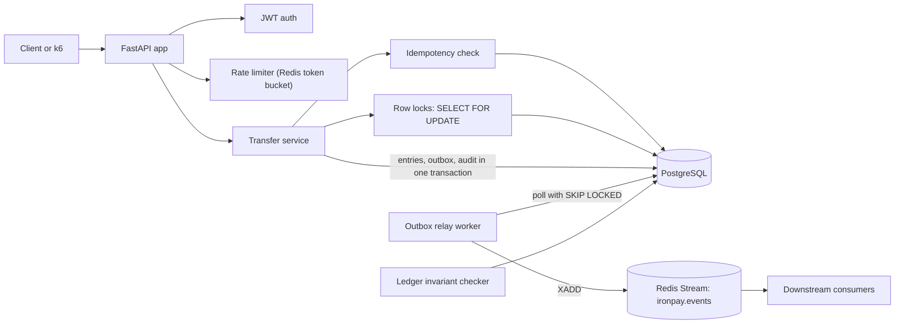

# IronPay LedgerAPI

A small UPI-style payments API with a double-entry ledger, idempotent transfers and tests that try to double-spend it.

Status: in development — design spec and build plan; results land as each phase ships.

         

---

## Why this exists

A payments backend has two jobs that are easy to get wrong: never lose or create money, and never apply the same payment twice. Mobile clients retry when the network drops, two requests can debit the same wallet in the same millisecond, and a crash can land between "money moved" and "event sent". Most CRUD tutorials store a `balance` column and update it in place, which fails all three cases. IronPay is a small API that handles them the way fintech teams do: an append-only double-entry ledger, idempotency keys, row locks, and an outbox table, with tests that attack each guarantee directly.

## What it does

- **Accounts and wallets** with UPI-style handles (`hasan@ironpay`), owned by a user, in a single currency (INR, stored as integer paise)
- **Double-entry ledger**: every transfer and deposit writes one debit and one credit entry of the same amount; balances are always computed from entries, never edited
- **Idempotent transfers**: `POST /transfers` takes an `Idempotency-Key` header; a retry with the same key and body returns the original response, a reused key with a different body is rejected
- **Concurrency safety**: account rows are locked with `SELECT ... FOR UPDATE` in a fixed order, so parallel transfers cannot overdraw a wallet or deadlock each other
- **JWT auth and Redis rate limiting**: users only see and move money from their own accounts; a token bucket per user (and per IP on login) returns `429` with `Retry-After`
- **Outbox and audit log**: each money movement writes an event row and an audit row in the same database transaction; a relay worker publishes events to a Redis Stream
- **OpenAPI docs** at `/docs`, with request and error examples (errors follow RFC 9457 problem details)
- **Tests that try to break it**: pytest unit and integration tests, a concurrent double-spend test, a ledger invariant checker, and k6 load tests

## Architecture



A request first passes JWT auth and the Redis rate limiter. For a transfer, the service opens one PostgreSQL transaction: it records the idempotency key, locks both account rows in id order, computes the sender's balance from ledger entries, and writes the transfer, two ledger entries, an outbox event and an audit row. Either all of that commits or none of it does. A separate relay worker reads unpublished outbox rows and pushes them to a Redis Stream, so a crash never leaves a payment without its event. The invariant checker reads the ledger after tests and load runs and confirms that money was neither created nor lost.

## How it works

### Ledger model

Every account (user wallets and one system funding account) has entries in `ledger_entries`. An entry has a direction (`debit` or `credit`) and a positive amount in paise. A wallet's balance is `sum(credits) - sum(debits)` over its entries. Deposits move money from the system funding account into a wallet, so money is never created out of nothing: across all accounts, total debits always equal total credits. Entries are append-only. A correction is a new pair of entries, never an `UPDATE`. Amounts are `BIGINT` paise to avoid floating point rounding.

### Transfers and concurrency

A transfer runs inside one transaction at `READ COMMITTED`. The service locks both account rows with `SELECT ... FOR UPDATE`, always in ascending id order, so two opposite transfers (A to B and B to A) cannot deadlock. While holding the lock it sums the sender's entries and checks the balance. A second request on the same wallet waits for the lock and then sees the committed entries of the first, so it cannot spend the same money. Pessimistic locking was chosen over optimistic versioning because wallets see frequent contention and retries under optimistic locking waste work; the trade-off is written up in [INFO.md](INFO.md).

### Idempotency

The client sends `Idempotency-Key: <uuid>` on `POST /transfers` and on deposits. The key is stored per user with a SHA-256 hash of the request body, inside the same transaction as the transfer, together with the final response. Three cases:

- New key: process the transfer and store the response
- Same key, same body: return the stored response with the original status code (no new entries)
- Same key, different body: return `422` so a client bug cannot silently reuse a key

If two requests with the same key arrive at once, the second one blocks on the unique index until the first commits, then replays its response. Business rejections such as insufficient funds are stored too, so a retry gets the same answer. Keys expire after 24 hours.

### Auth and rate limiting

Users register and get a short-lived JWT access token (HS256, 15 minutes) from `POST /auth/token`. Passwords are hashed with Argon2. Every account and transfer query is scoped to the token's user id, so guessing another account's id returns `404`. Rate limiting is a token bucket in Redis, implemented as a small Lua script so the read-and-decrement is atomic. If Redis is down the limiter fails open and logs a warning, because rate limiting protects capacity while correctness is guaranteed by PostgreSQL.

### Outbox and audit log

The transfer transaction also inserts a `transfer.completed` or `transfer.rejected` row into `outbox_events`. The relay worker selects unpublished rows with `FOR UPDATE SKIP LOCKED`, publishes them to a Redis Stream with `XADD`, and marks them published. Delivery is at-least-once, so each event carries an `event_id` that consumers use to drop duplicates. The `audit_log` table records who did what (actor, action, entity, request id, IP) and is append-only: a trigger rejects `UPDATE` and `DELETE`.

### Testing strategy

Unit tests cover pure logic (balance math, request hashing, token bucket refill). Integration tests run against real PostgreSQL and Redis containers, never mocks, because the guarantees live in the database. The concurrent double-spend test funds a wallet with 100 rupees, fires 50 parallel transfers of 10 rupees from separate connections, and asserts that exactly 10 succeed, the wallet ends at zero, and the ledger checker reports no drift. k6 scripts measure latency at a fixed arrival rate, ramp up to find the error point, and replay the same idempotency keys to confirm zero duplicate transfers.

## Tech stack

| Layer | Tools | Why |
|---|---|---|
| API | FastAPI, Pydantic v2 | Typed request validation, dependency injection for auth and DB sessions, OpenAPI docs generated from the code |
| Database | PostgreSQL 16 | ACID transactions, row-level locks, `SKIP LOCKED`, constraints and triggers for invariants |
| Data access | SQLAlchemy 2 (sync, psycopg 3), Alembic | Explicit transactions and `with_for_update()`; versioned, reviewable migrations |
| Cache and limits | Redis 7 | Atomic Lua token bucket for rate limiting; Redis Stream as the event sink for the outbox relay |
| Auth | PyJWT, Argon2 (pwdlib) | Stateless access tokens; a memory-hard password hash |
| Testing | pytest, pytest-cov, httpx | Fixtures for real Postgres and Redis, concurrent tests, coverage report |
| Load testing | k6 | Arrival-rate scenarios and thresholds on p95 latency and error rate |
| Packaging | Docker, Docker Compose | One command starts API, worker, Postgres and Redis |
| Observability | prometheus-fastapi-instrumentator | `/metrics` for request rate, latency and errors; scraped by Prometheus in CloudShip and read by IncidentIQ |
| Quality and CI | ruff, GitHub Actions | Lint and format checks, tests with service containers, image build |

## Project structure

```
IronPay-LedgerAPI/
├── app/
│   ├── main.py              # FastAPI app, routers, error handlers
│   ├── config.py            # settings from environment
│   ├── db.py                # engine and session factory
│   ├── models.py            # SQLAlchemy tables
│   ├── schemas.py           # Pydantic request and response models
│   ├── security.py          # JWT and password hashing
│   ├── ratelimit.py         # Redis token bucket (Lua)
│   ├── routes/              # auth, accounts, transfers, health
│   └── services/            # ledger, transfers, idempotency, outbox, audit
├── worker/
│   └── outbox_relay.py      # publishes outbox rows to a Redis Stream
├── migrations/              # Alembic versions
├── scripts/
│   ├── seed.py              # demo users and wallets
│   └── check_ledger.py      # ledger invariant checker
├── tests/
│   ├── unit/
│   └── integration/         # includes test_double_spend.py
├── loadtest/                # k6 scripts
├── docs/
│   ├── results/             # raw k6, coverage and checker output
│   └── screenshots/
├── .github/workflows/ci.yml
├── docker-compose.yml
├── Dockerfile
├── Makefile
├── alembic.ini
├── pyproject.toml           # ruff and pytest config
├── requirements.txt
├── requirements-dev.txt
└── .env.example
```

## Getting started

Target workflow once Phase 1 lands.

**Prerequisites:** Docker with Compose v2, Python 3.11 (for running tests outside Docker), k6 (for load tests), and `make` (on Windows, use Git Bash or run the `docker compose` commands in the Makefile directly).

```bash
git clone https://github.com/striderzz/IronPay-LedgerAPI.git
cd IronPay-LedgerAPI
cp .env.example .env          # set JWT_SECRET; defaults work for local use

make up                       # docker compose up --build: api, relay, postgres, redis
make migrate                  # alembic upgrade head
make seed                     # demo users and funded wallets
```

Open http://localhost:8000/docs for the interactive API docs.

```bash
make test                     # ruff + pytest (unit and integration) with coverage
make load                     # k6 scenarios against the running stack
make check-ledger             # ledger invariant check, prints drift
```

Example transfer:

```bash
curl -X POST http://localhost:8000/transfers \
  -H "Authorization: Bearer $TOKEN" \
  -H "Idempotency-Key: 7d3c2a8e-1b9f-4c51-9a0e-2f6b8d4e5c11" \
  -H "Content-Type: application/json" \
  -d '{"from_account_id": "<uuid>", "to_handle": "riya@ironpay", "amount_minor": 25000, "note": "dinner"}'
```

## Results

No numbers yet. Each value is measured after Phase 5; raw output in docs/results/.

| Metric | Value | How it is measured |
|---|---|---|
| p50 latency, `POST /transfers` | — | k6 `constant-arrival-rate` scenario at a fixed rate on the Docker Compose stack; hardware listed with the result |
| p95 latency, `POST /transfers` | — | Same k6 run |
| Max transfers/sec before errors | — | k6 `ramping-arrival-rate`; highest rate with error rate under 1% and p95 under the threshold |
| Balance drift after N concurrent transfers | — | `scripts/check_ledger.py` after the double-spend test and after each k6 run; expected 0 |
| Duplicate transfers under retry storm | — | k6 scenario that resends each request with the same Idempotency-Key; count of transfers vs unique keys; expected 0 |
| Test coverage | — | `pytest --cov=app` in CI |

## Roadmap

- [ ] Phase 1: scaffold (FastAPI app, config, PostgreSQL + Alembic, Docker Compose, health check, Prometheus `/metrics`, pytest, ruff, GitHub Actions CI)
- [ ] Phase 2: ledger core (users, accounts and handles, deposits, double-entry transfers with row locks, derived balances, entry history, double-spend test, invariant checker)
- [ ] Phase 3: API safety (JWT auth and ownership checks, Idempotency-Key on transfers and deposits, Redis rate limiting, problem details errors)
- [ ] Phase 4: events and audit (outbox table, relay worker to Redis Stream, append-only audit log, JSON logs with request id)
- [ ] Phase 5: load and results (k6 scenarios, invariant check after load, coverage, numbers in README from docs/results/)
- [ ] Phase 6: polish (OpenAPI examples, screenshots, image push to GHCR on main, how-it-works notes in docs/)

## Stretch goals

- **Kafka publishing**: swap the relay's Redis Stream publisher for Kafka (Redpanda in Compose), keyed by account id so events for one account stay ordered
- **Fraud score before approval**: call [FraudSight](https://github.com/striderzz/FraudSight-MLOps) for a score before committing a transfer; high scores move the transfer to a `held` state for review, with a short timeout and a rule-based fallback if FraudSight is down
- **Ledger analytics**: export entries to Parquet and build DuckDB + dbt models for daily settlement totals and rejection rates
- **Reversals**: `POST /transfers/{id}/reversal` that writes compensating entries instead of editing history
- **Optimistic locking variant**: a version-column implementation behind a flag, benchmarked against `FOR UPDATE` with the same k6 scripts
- **Fault injection**: opt-in fault toggles (slow queries, Redis outage) for incident drills

## Related projects

- [CloudShip DevOps](https://github.com/striderzz/CloudShip-DevOps): deploys IronPay to AWS
- [IncidentIQ AgentOps](https://github.com/striderzz/IncidentIQ-AgentOps): investigates incidents injected into IronPay
- [FraudSight MLOps](https://github.com/striderzz/FraudSight-MLOps): can score IronPay transfers for fraud (stretch goal)

## Author

Hasan · [GitHub](https://github.com/striderzz) · [LinkedIn](https://www.linkedin.com/in/hasan-m-4b1bba315) · [Portfolio](https://striderzz.github.io/portfolio-website)

## License

MIT
