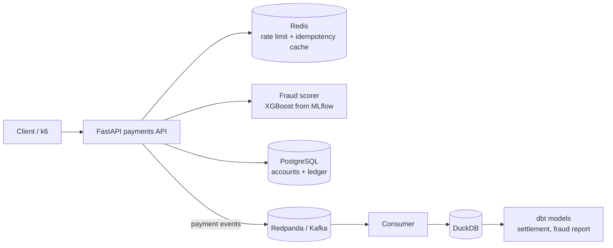

# Ironbank – Payments Ledger

**A payments API with a double-entry ledger, safe retries, real-time fraud scoring and an analytics layer**

FastAPI · PostgreSQL · Redis · Redpanda (Kafka) · XGBoost · MLflow · DuckDB · dbt · Docker Compose · k6 · GitHub Actions · Claude API · OpenAI API · custom LLMs

> **Status: under active development.** This README is the design spec. The checklist in the [Roadmap](#roadmap) shows what is built so far.

---

## Overview

Ironbank is a small UPI-style payments service built the way fintech teams build the core of theirs:

- **Every rupee is tracked** in a double-entry ledger, so every transfer creates balanced debit and credit entries.
- **A payment is never applied twice**, even if the client retries after a timeout (idempotency keys + database transactions).
- **Every transfer is scored for fraud** by an XGBoost model before it is accepted.
- **Every event is streamed** to Kafka and lands in a small analytics layer (DuckDB + dbt) for daily settlement and fraud reports.

| Area | What it shows |
|---|---|
| **Backend engineering** | REST API design, transactions and row locking, idempotency, rate limiting with Redis, tests, load testing |
| **Data engineering** | Event streaming with Kafka, a consumer that loads events into DuckDB, dbt models with tests |
| **Machine learning** | Fraud model trained on a public dataset, tracked in MLflow, served inside the API |

## Architecture



## Key features

- `POST /transfers` with an `Idempotency-Key` header: retries return the original result instead of creating a second payment
- Double-entry ledger with a test that checks every transfer balances to zero
- Concurrent transfers on the same account handled safely (`SELECT ... FOR UPDATE`)
- Fraud score returned with each transfer, and high-risk transfers held for review
- Fraud model trained in a notebook, then logged and loaded from MLflow
- dbt models for daily totals, failed-payment rates and fraud flags

## Results to publish (only from real runs)

| Metric | How it is measured |
|---|---|
| Requests per second and p95 latency | k6 load test |
| Duplicate payments under retries | Retry test (expected: 0) |
| Fraud model PR-AUC and recall | Held-out test set |

## AI features

- **Fraud explainer:** when a transfer is held, Claude reads the model's score, the top contributing features (SHAP) and the account's recent history. It returns a **structured JSON verdict** for the review queue: a risk summary, the reasons, and a recommended action.
- **Ask your ledger:** an analyst types a question such as "Which merchants had the most failed payments this week?" Claude uses **tool use** to write a read-only SQL query against the DuckDB/dbt tables. The app validates the query (SELECT only, approved tables), runs it, and Claude explains the result.
- **Provider comparison:** the explainer is scored on 50 labelled held transfers with Claude, OpenAI and a custom model. Accuracy, cost and latency are published side by side.

## LLM providers and API keys

Every AI feature goes through one small provider layer, so you can switch models without touching the rest of the code.

| Provider | How it is called | Used for |
|---|---|---|
| **Claude** (default) | Official `anthropic` Python SDK | Reasoning, tool use, structured outputs, vision, PDF citations |
| **OpenAI** | Official `openai` Python SDK | Alternative chat model, embeddings, speech-to-text |
| **Custom LLM** | Any OpenAI-compatible endpoint: base URL + API key + model name | Gemini, Groq, DeepSeek, OpenRouter, a local Ollama model, or anything else not listed |

**Setting keys:** use either option.
1. Copy `.env.example` to `.env` and fill in `ANTHROPIC_API_KEY`, `OPENAI_API_KEY`, or the `CUSTOM_LLM_*` values.
2. Or open the app's **Settings** page, paste keys, pick a provider and model per feature, and press **Test connection**. Keys are saved locally in a gitignored file, shown masked, and never logged.

**Staying within budget:**
- Each call's tokens and cost are logged.
- A monthly budget cap (set in Settings) stops AI calls once it is reached.
- Long, stable prompts use prompt caching.
- Offline evaluations run through the Message Batches API at half the price.
- Bulk steps can use a cheaper model, chosen per feature in Settings. The defaults are `claude-opus-5-5` for the main reasoning step and `claude-haiku-5-5` for bulk steps.

## Repository structure

```
ironbank-payments-ledger/
├── requirements.txt
├── .env.example
├── app/            # FastAPI: routes, ledger, idempotency, fraud scoring
├── ml/             # training notebook + MLflow logging
├── pipeline/       # Kafka consumer + dbt project (DuckDB)
├── loadtest/       # k6 scripts
├── tests/          # pytest
├── docs/           # screenshots, results
├── docker-compose.yml
└── .github/workflows/ci.yml
```

## Roadmap

- [ ] Provider layer (Claude, OpenAI, custom), Settings page, budget cap
- [ ] Accounts, ledger and transfers API with tests
- [ ] Idempotency keys and Redis rate limiting
- [ ] Fraud model training + MLflow + scoring in the API
- [ ] Kafka events → DuckDB → dbt models
- [ ] k6 load test with published results
- [ ] AI features + provider comparison
- [ ] CI, screenshots, demo GIF

## Author

**Hasan Mohd Hussain**: [GitHub](https://github.com/striderzz) · [LinkedIn](https://www.linkedin.com/in/hasan-m-4b1bba315/) · [Portfolio](https://striderzz.github.io/portfolio-website/)
